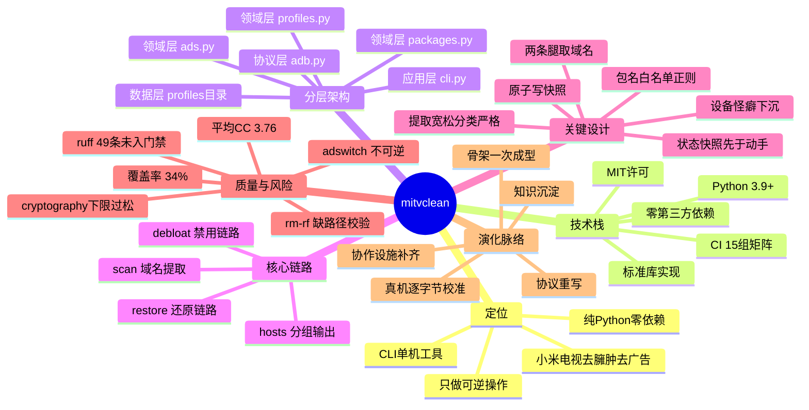

# mitvclean 项目全景思维导图

- **分析对象**：`mitvclean`
- **数据来源**：本目录五份分析报告的结论汇总
- **分析日期**：2026-10-21
- **说明**：本导图节点只引用已有报告中的结论，不引入新判断

## 一、Mermaid 源码



## 二、纯文本缩进树

```
mitvclean
├── 定位
│   ├── 小米电视去臃肿去广告
│   ├── 纯 Python 零依赖
│   ├── 只做可逆操作
│   └── CLI 单机工具
├── 技术栈
│   ├── Python 3.9+
│   ├── 零第三方依赖（间接依赖 0）
│   ├── 标准库实现（socket/struct/zipfile/re）
│   ├── MIT 许可（唯一可选依赖 Apache-2.0 双许可）
│   └── CI 15 组矩阵（3.9–3.13 × 3 OS）
├── 分层架构
│   ├── 应用层 cli.py（9 个子命令）
│   ├── 领域层 packages.py（可逆包管理，CC 14）
│   ├── 领域层 ads.py（广告域提取，CC ≤10）
│   ├── 领域层 profiles.py（机型数据层）
│   ├── 协议层 adb.py（513 行，CC ≤8）
│   └── 数据层 profiles/ + work/
├── 核心链路
│   ├── debloat：判定→落盘→逐条执行→复查
│   ├── scan：logcat 动态腿 + APK 静态腿 → 并集
│   ├── hosts：--group N 分批输出（34/31/8）
│   └── restore：只恢复原本 enabled 的
├── 关键设计
│   ├── 状态快照先于动手（packages.py:184）
│   ├── 原子写快照（packages.py:141）
│   ├── 包名白名单正则（packages.py:23）
│   ├── 两条腿取并集（cli.py:222）
│   ├── 设备怪癖下沉为通用契约（adb.py:392）
│   └── 提取宽松分类严格（ads.py:33/89）
├── 质量与风险
│   ├── 平均 CC 3.76（优）｜热点 cmd_doctor 17
│   ├── 覆盖率 34%（保守口径）
│   ├── ruff 49 条，CI 未接（缺口）
│   ├── adswitch 不记原值（承诺破口 P0）
│   ├── rm -rf 缺路径校验（P0）
│   └── cryptography>=3.4 下限过松（P0）
└── 演化脉络（3 小时 13 分 5 次提交）
    ├── 阶段A 骨架一次成型（决策全存活）
    ├── 阶段B 协议重写（诞生假 adbd 测试）
    ├── 阶段C 真机逐字节校准（4 处偏差）
    ├── 阶段D 知识沉淀（协议笔记）
    └── 阶段E 协作设施 + hosts 分组
```

## 三、3 分钟讲清这个项目

**这是什么**：一个 2 千行的纯 Python 命令行工具，帮用户清理小米电视的后台包和广告。零第三方依赖，装在电视上跑，不需要 root。

**怎么分层**：四层单向依赖。`adb.py` 是唯一碰网络的一层（自研 ADB 协议客户端），`packages.py`/`ads.py`/`profiles.py` 是业务层，`cli.py` 是编排层，`profiles/` 目录是数据层。加新机型零代码改动。

**核心链路在哪**：
- 禁用包：`query_state` → `save_record`（先落盘）→ 逐条 `pm disable-user` → 复查
- 抓广告域名：logcat 动态腿 + APK 静态腿，两腿取**并集**（单腿必漏）
- 还原：按快照只恢复原本 enabled 的

**最该记住的三个结论**：
1. 项目最大的技术资产是 `docs/ADB协议实现笔记.md` —— 4 处协议偏差都是抓包发现的，**读文档发现不了**
2. 项目最大的承诺破口在 `ads.py:217` `set_ad_settings` 不记原值，与"只做可逆操作"自相矛盾
3. 项目最划算的下一步是把 `ruff check` 接进 CI —— 49 条告警 10 条可自动修，成本 5 行

**引用出处**：
- 分层与数据流 →《mitvclean 架构实现分析》
- 演化阶段与决定性重构 →《mitvclean 基础层与领域模型演化分析》
- 基本事实与 13 项巧思 →《mitvclean 第一性原理与设计巧思分析》
- 指标与 P0/P1/P2 清单 →《mitvclean 代码质量评估》
- 技术栈矩阵与二开成本 →《mitvclean 技术栈拆解》
